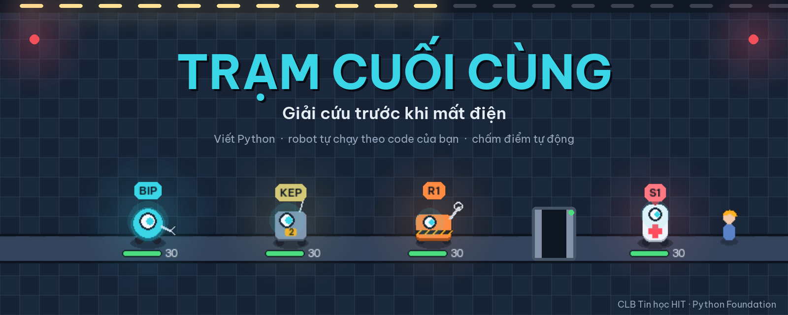

<p align="center"></p>

# Hướng dẫn học viên

> **Hiện mới mở khu Luyện tập.** Các màn kiểm tra sẽ mở vào ngày kiểm tra. Hôm đó chạy `git pull` (hoặc tải lại ZIP) để có thêm các màn; bài luyện của bạn vẫn giữ nguyên.

Đọc lướt mục 1–3 là đủ để bắt đầu. Các mục sau để tra khi cần.

## 1. Cài một lần

Làm theo phần **Cài một lần** trong mục **Cài một lần** bên dưới. Sau đó mở thư mục game bằng VS Code và chọn interpreter là `.venv`:

- Bấm **Ctrl+Shift+P**, gõ *Python: Select Interpreter*, rồi chọn dòng có chữ `.venv`.

Từ lần sau chỉ cần chạy `main.py`. Game sẽ nhớ màn bạn đang làm.

## 2. Mỗi lần làm bài

```
Sửa code  →  Lưu (Ctrl+S)  →  Bấm "Chạy lại code" (F5)  →  Xem robot làm
```

Không cần tắt game. Mỗi lần chạy lại, thế giới được đặt lại từ đầu và game dùng code mới nhất của bạn.

## 3. Bắt đầu từ đâu

1. **Luyện tập** (tab đầu tiên): 7 bài nhỏ trong `student/practice/`. Bấm **F1** để xem đề, nhấn **H** để mở gợi ý.
2. **Màn 0 → 3**: làm theo thứ tự nào cũng được. Màn nào cũng có điểm riêng.

Mỗi file chỉ cần có hàm `run(ctx)`:

```python
def run(ctx):
    ctx.activate("BIP")
    ctx.say("BIP", "Xin chào!")
    ctx.move_to("BIP", "rally_point")
```

`ctx` là bộ công cụ. Xem danh sách công cụ bằng **F1** trong game hoặc [Bảng công cụ](docs/BANG_CONG_CU.md).

## 4. Bị từ chối thì sao?

Mỗi lệnh trả về một kết quả. Bạn có thể đọc kết quả đó để quyết định làm gì tiếp:

```python
kq = ctx.open_gate("BIP", "gate_A")
if not kq.ok:
    print(kq.reason)   # ví dụ: missing_card (thiếu thẻ)
```

Bị từ chối **không mất điểm**. Robot chỉ đứng yên, việc của bạn là thử cách khác.

## 5. Khi code bị lỗi

Game hiện khung đỏ với **tên file, số dòng, đúng dòng code bị lỗi** và một gợi ý. Các lỗi hay gặp:

| Thấy | Thường do |
|---|---|
| `... đang là None` | Hàm của bạn quên `return` |
| `NameError` | Gõ sai tên biến hoặc tên hàm |
| `KeyError` | Dict không có khóa đó, hãy `print` dict ra xem |
| *Chạy quá thời gian* | Vòng lặp `while` không bao giờ dừng |

Lỗi ở màn này không ảnh hưởng màn khác. Những gì robot làm được trước khi lỗi vẫn được tính.

## 6. Phím tắt

| Phím | Việc |
|---|---|
| F5 | Chạy lại code |
| F6 | Chấm màn này / kiểm tra bài luyện |
| F7 | Chấm cả bài |
| F1 | Đề và công cụ (bài luyện: nhấn H để xem gợi ý) |
| F2 | Xem kết quả đã lưu |
| Space | Tạm dừng / tiếp tục |

## 7. Chấm điểm như thế nào

- Chấm theo **việc robot thật sự làm được**, ví dụ "Đã giao 4/6 kiện". Không chấm code đẹp hay ngắn.
- Có nhiều cách làm đúng. Đi từng chuyến hay gom hàng đều được, miễn đạt mục tiêu.
- Màn 2 và 3 có điểm OOP: tự viết lớp con (`PlannerBase`, `RobotBase`) và thực sự dùng chúng.
- Khi chấm chính thức, bài còn chạy trên **bản đồ khác cùng luật** (tên và thứ tự có thể khác). Hãy lấy dữ liệu qua `ctx`, **đừng viết cứng id**.

## 8. Hỏi nhanh

- **Có cần viết nhiều file không?** Không. Mỗi màn một file là đủ. Bạn có thể thêm file helper trong `student/` nếu muốn.
- **Truyền nguyên dict có được không?** Được: `ctx.move_to(robot, nơi)` với `robot` lấy từ `ctx.robots()`.
- **Điểm trong game có phải điểm chính thức không?** Không. Đó là điểm thử. Giảng viên sẽ chấm lại từ code bạn nộp.

## Cài một lần

Cần **Python 3.10 trở lên**. Cài xong thì chơi được không cần mạng.

**Windows**
```bat
py -m venv .venv
.venv\Scripts\python.exe -m pip install -r requirements.txt
.venv\Scripts\python.exe main.py
```

**Ubuntu**
```bash
python3 -m venv .venv
.venv/bin/python -m pip install -r requirements.txt
.venv/bin/python main.py
```

