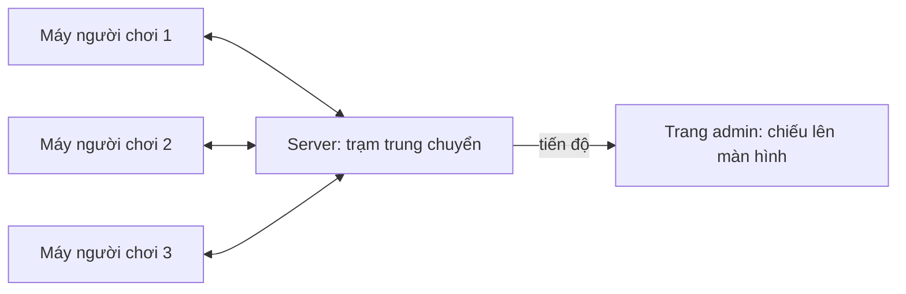

# Đề xuất cải tiến

## Mục tiêu

Đưa người chơi từ chơi độc lập sang cạnh tranh và hợp tác khi chơi thật.

- **Cạnh tranh:** chiếu tiến độ của mọi người chơi lên màn hình chung trong buổi chơi.
- **Hợp tác:** có màn chơi mà cả đội phải phối hợp mới qua được.

## Đề xuất 1: Trang admin hiển thị tiến độ

Một trang admin hiển thị tình trạng màn chơi của từng người chơi, để chiếu lên màn hình khi chơi thật.

- Thông tin được cập nhật khi người chơi bấm nộp bài.
- Mỗi người chơi thấy mình đang ở đâu so với những người khác, tạo động lực cạnh tranh.

Hiện game chạy offline hoàn toàn và chưa có nút nộp bài, nên đề xuất này cần thêm nút nộp trong game và một server nhận kết quả.

## Đề xuất 2: Chế độ đội nhóm

Màn chơi có 2–3 robot, mỗi người trong đội viết code điều khiển một con.

- Đội chỉ qua màn khi các robot hợp sức, giống lối chơi cậu bé lửa và cô bé nước.
- Game đã có sẵn nhiều robot với chuyên môn khác nhau (sửa chữa, cứu hộ) và cổng cần thẻ, nên có thể dựa vào đó để thiết kế việc cần nhau.
    - Ví dụ: robot A mở cổng thì robot B mới đi qua được để cứu người.

## Vai trò của server

Server chỉ là trạm trung chuyển thông tin, không chạy game thay người chơi.

- Lên server: kết quả khi nộp bài, hành động robot (chế độ đội).
- Về máy người chơi: trạng thái robot của đồng đội (chế độ đội).

Game không có tính đối kháng nên độ trễ có thể chấp nhận được, nhờ đó giảm đáng kể gánh nặng phần cứng cho server.

## Câu hỏi cần chốt với ban tổ chức

- [ ] Người chơi nộp bài theo cách nào, và có thể chuyển sang nút nộp trong game không?
- [ ] Trang admin hiển thị những gì: màn đã qua, điểm thử, hay thời điểm nộp?
- [ ] Phòng chơi có mạng chung không, server đặt ở máy giảng viên hay trên mạng?
- [ ] Chế độ đội nhóm tính điểm chung cả đội hay điểm riêng từng người?
