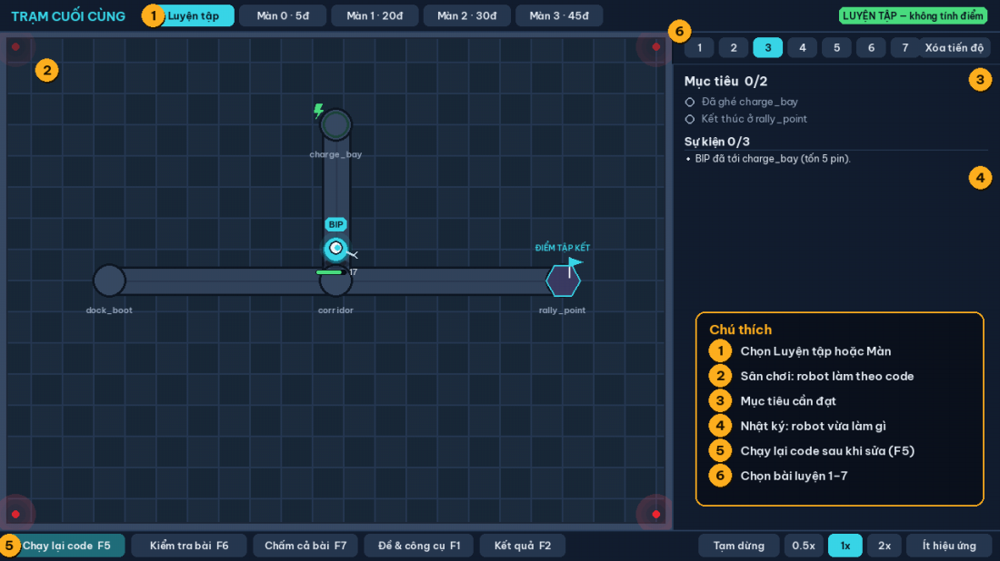

# 2. Làm quen giao diện

| Số | Khu vực | Dùng để |
|---|---|---|
| 1 | Thanh chọn | **Luyện tập** (7 bài nhỏ) hoặc **Màn 0–3** (bài kiểm tra) |
| 2 | Sân chơi | Robot làm đúng theo code của bạn |
| 3 | Mục tiêu | Mục nào xong sẽ có dấu tích ✓ |
| 4 | Nhật ký | Robot vừa làm gì. Dòng màu **cam** là bị từ chối, màu **đỏ** là code lỗi |
| 5 | Nút điều khiển | Chạy lại, chấm, xem đề... (bảng dưới) |
| 6 | Chọn bài luyện | Bài 1 → 7. Bài nào xong có dấu tích |

## Các nút và phím tắt

| Nút | Phím | Khi nào dùng |
|---|---|---|
| Chạy lại code | **F5** | Sau mỗi lần sửa và lưu code |
| Kiểm tra bài / Chấm màn này | **F6** | Muốn biết mình đạt chưa |
| Chấm cả bài | F7 | Chấm tất cả các màn đã mở |
| Đề & công cụ | **F1** | Xem đề, danh sách công cụ. Ở bài luyện, nhấn **H** để mở gợi ý |
| Kết quả | F2 | Xem điểm lần chấm gần nhất |
| Tạm dừng / 0.5x 1x 2x | Space | Xem chậm lại để hiểu robot đang làm gì |

> Game **không có ô gõ code**. Bạn viết code bằng VS Code, lưu, rồi bấm F5 trong game.

➡️ Tiếp theo: [3. Bài đầu tiên](03-bai-dau-tien.md)
