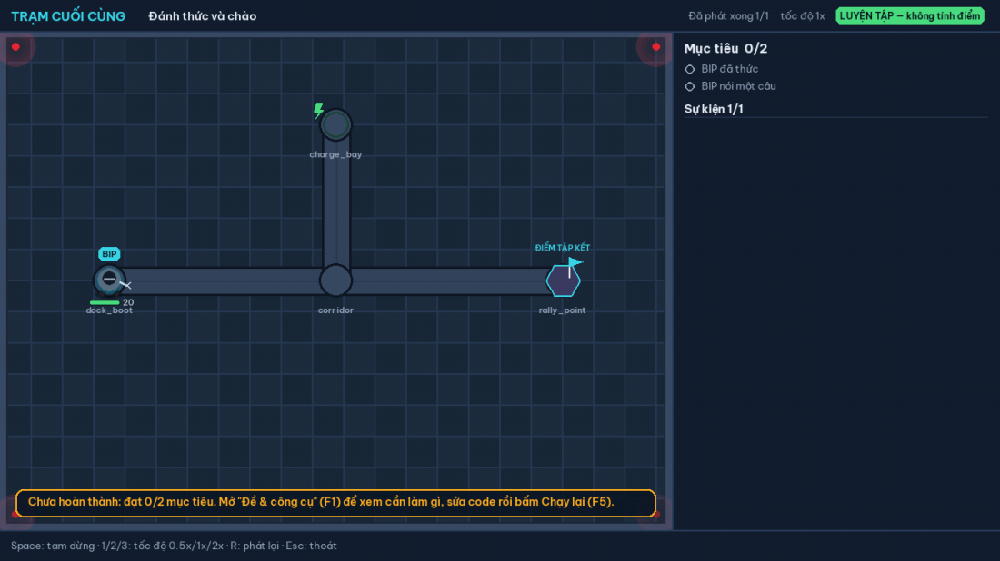
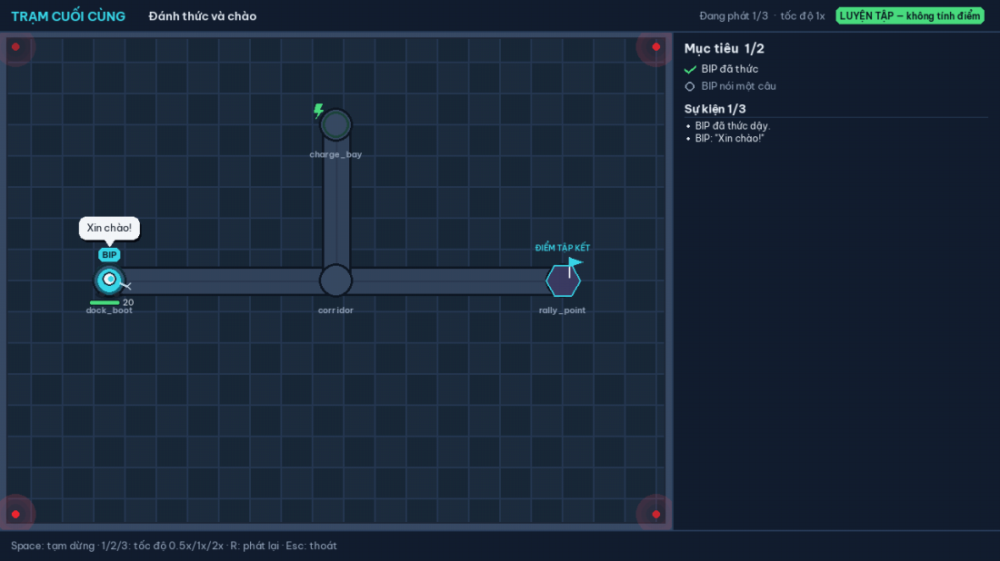
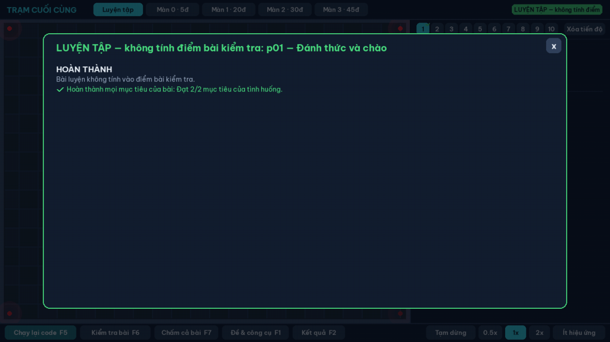
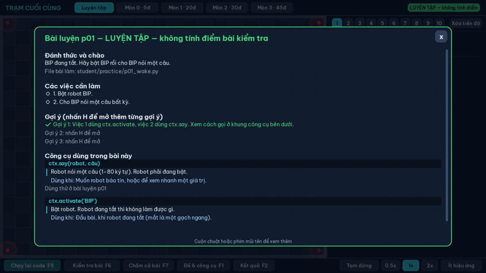

# 3. Bài đầu tiên: đánh thức BIP

Mục tiêu bài luyện 1: **bật robot BIP** và cho BIP **nói một câu**.

## Bước 1: Mở game ở bài 1

Chọn tab **Luyện tập**, bài **1**. Lúc này BIP đang tắt (mắt là một gạch ngang) và game báo *Chưa hoàn thành*:



## Bước 2: Mở file bài làm

Trong VS Code mở `student/practice/p01_wake.py`. Bạn sẽ thấy:

```python
def run(ctx):
    pass
```

- `run(ctx)` là nơi bạn viết code. Game tự gọi hàm này.
- `ctx` là **bộ công cụ** để ra lệnh cho robot.

## Bước 3: Viết code

Thay `pass` bằng hai lệnh:

```python
def run(ctx):
    ctx.activate("BIP")
    ctx.say("BIP", "Xin chào!")
```

## Bước 4: Lưu file và chạy

1. Lưu file (**Ctrl+S**).
2. Quay lại game, bấm **Chạy lại code (F5)**.

BIP sáng mắt và nói:



## Bước 5: Kiểm tra bài

Bấm **Kiểm tra bài (F6)**:



🎉 Xong bài đầu tiên! Chưa xong thì bấm **F1** để xem **các việc cần làm**, rồi nhấn **H** để mở từng gợi ý.



## Thử thêm

- Đổi câu nói thành tên bạn, lưu, rồi F5.
- Đảo hai dòng (nói trước, bật sau) xem chuyện gì xảy ra. Gợi ý: đọc dòng màu cam ở nhật ký.

➡️ Tiếp theo: [4. Đọc thông tin](04-doc-thong-tin.md)
