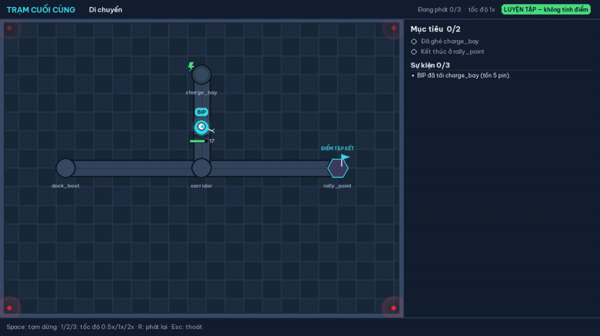

# 5. Di chuyển và pin

## Đi tới một nơi

```python
def run(ctx):
    ctx.move_to("BIP", "charge_bay")
    ctx.move_to("BIP", "rally_point")
```

Bạn chỉ cần nói **tên nơi đến**, game tự tìm đường:



## Pin

- Đi càng xa càng tốn pin. Số pin hiện ngay dưới robot.
- **Không đủ pin thì robot không đi**: lệnh bị từ chối với lý do `low_battery`, robot đứng yên.

Xem trước một chặng tốn bao nhiêu pin:

```python
def run(ctx):
    can = ctx.route_cost("BIP", "rally_point")
    con = ctx.robot("BIP")["battery"]
    if can is not None and can > con:
        ctx.go_charge("BIP")          # tự đi tới trạm sạc gần nhất và sạc đầy
    ctx.move_to("BIP", "rally_point")
```

| Công cụ | Làm gì |
|---|---|
| `ctx.move_to(robot, nơi)` | Đi tới nơi đó |
| `ctx.route_cost(robot, nơi)` | Cần bao nhiêu pin (`None` nếu chưa có đường) |
| `ctx.charge(robot)` | Sạc đầy, phải đang đứng ở trạm sạc |
| `ctx.go_charge(robot)` | Tự đi tới trạm sạc gần nhất rồi sạc |

🧪 Luyện: **bài 3** (di chuyển), **bài 8** (pin và trạm sạc: dùng `route_cost`, `charge`).

➡️ Tiếp theo: [6. Bị từ chối thì làm gì?](06-bi-tu-choi.md)
