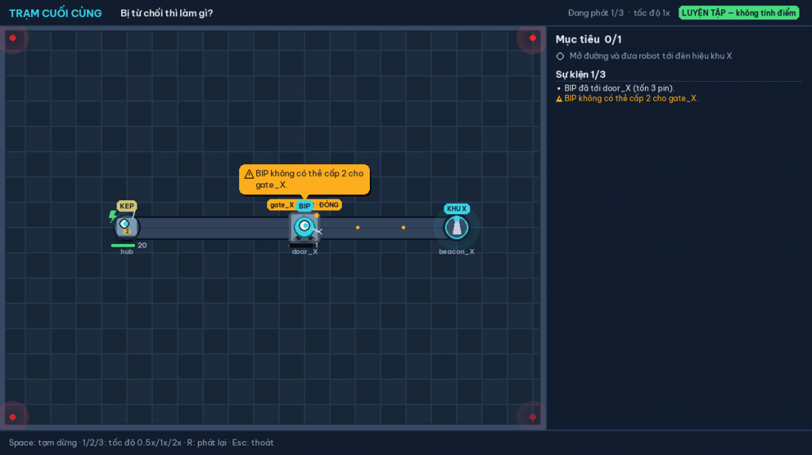

# 6. Bị từ chối thì làm gì?

Mỗi lệnh trả về một **kết quả**. Khi lệnh bị từ chối, robot đứng yên, game hiện bong bóng màu cam và **không mất điểm**:



## Đọc kết quả

```python
def run(ctx):
    ctx.move_to("BIP", "door_X")
    kq = ctx.open_gate("BIP", "gate_X")
    if kq.ok:
        print("Mở được!")
    else:
        print("Không mở được vì:", kq.reason)
        print(kq.message)            # giải thích bằng tiếng Việt
```

| Thuộc tính | Ý nghĩa |
|---|---|
| `kq.ok` | `True` nếu lệnh thành công |
| `kq.reason` | Mã lý do ngắn, ví dụ `"missing_card"` |
| `kq.message` | Câu giải thích tiếng Việt |

Viết gọn cũng được: `if ctx.open_gate("BIP", "gate_X"):`

## Các lý do hay gặp

| `reason` | Nghĩa | Thử làm gì |
|---|---|---|
| `inactive` | Robot chưa bật | `ctx.activate(...)` |
| `low_battery` | Không đủ pin | `ctx.go_charge(...)` |
| `no_path` | Chưa có đường (cổng còn đóng) | Mở cổng trước |
| `missing_card` | Thiếu thẻ đúng cấp | Dùng robot khác có thẻ |
| `not_here` / `not_at_gate` | Đứng sai chỗ | `move_to` tới đúng chỗ trước |
| `over_capacity` | Chở quá nặng | Giao bớt rồi quay lại |

## Hai cách đều đúng

- **Thử rồi xử lý:** gọi lệnh, nếu `kq.ok` là `False` thì làm cách khác.
- **Kiểm tra trước:** xem `robot["cards"]`, `route_cost`... rồi mới gọi.

Chọn cách nào cũng được điểm như nhau.

🧪 Luyện: **bài 4** (bị từ chối), **bài 9** (cổng và thẻ: dùng `gates`, `check_gate` để chọn đúng robot).

➡️ Tiếp theo: [7. Vòng lặp và giao hàng](07-giao-hang.md)
