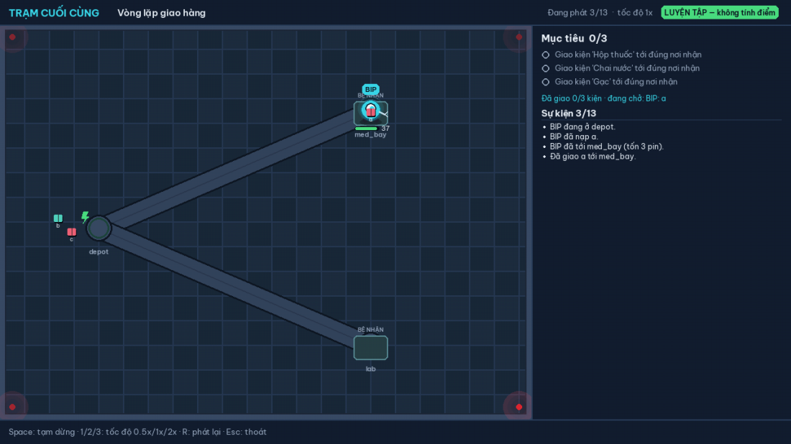

# 7. Vòng lặp và giao hàng (dùng cho Màn 2)

## Danh sách kiện

```python
def run(ctx):
    for p in ctx.packages():
        print(p["id"], p["weight"], "đang ở", p["location"], "→ cần tới", p["destination"])
```

| Khóa | Ý nghĩa |
|---|---|
| `"location"` | Kiện đang nằm ở đâu |
| `"destination"` | Nơi phải giao tới |
| `"weight"` | Khối lượng |
| `"status"` | `"waiting"` chờ giao, `"loaded"` đang chở, `"delivered"` đã giao |

## Giao từng kiện bằng vòng lặp

```python
def run(ctx):
    for p in ctx.packages():
        ctx.move_to("BIP", p["location"])        # tới chỗ kiện
        ctx.load("BIP", p["id"])                  # nạp lên robot
        ctx.move_to("BIP", p["destination"])     # tới nơi nhận
        ctx.unload("BIP", p["id"])                # dỡ xuống
```



- Chỉ tính **đã giao** khi dỡ **đúng nơi nhận**. Dỡ sai chỗ thì kiện nằm lại đó, có thể nạp lại.
- Robot có **sức chứa**: nạp quá thì bị từ chối (`over_capacity`). Xem `ctx.cargo("BIP")`.
- Đi từng kiện hay gom nhiều kiện cùng nơi nhận **đều được điểm như nhau**.

## Phần OOP của Màn 2: lớp `PlannerBase`

Gói phương án của bạn vào một lớp con:

```python
from game_api import PlannerBase


class GiaoHang(PlannerBase):
    def __init__(self):
        super().__init__("Kế hoạch của em")
        self.da_giao = []

    def execute(self, ctx):
        # Viết cách giao hàng ở đây, giống như trong run.
        # Giao xong kiện nào thì self.da_giao.append(id_kiện)
        pass

    def report(self):
        return self.da_giao


def run(ctx):
    ctx.use_planner(GiaoHang())
```

Có hai điều kiện để được điểm OOP:
1. Object **thực sự giao được hàng** bên trong `execute`.
2. `report()` trả về **đúng** các kiện đã giao.

🧪 Luyện: **bài 5** (vòng lặp giao hàng), **bài 10** (khoang hàng có giới hạn, `cargo`, `receipts`, `PlannerBase`).

➡️ Tiếp theo: [8. Đội robot của bạn](08-doi-robot.md)
