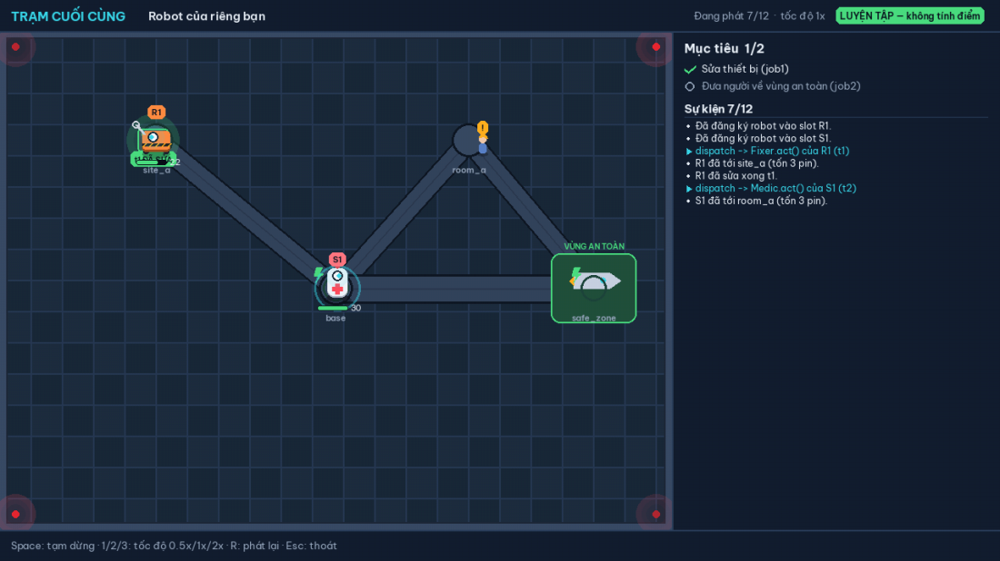

# 8. Đội robot của bạn (dùng cho Màn 3)

Màn 3 có hai loại việc: **sửa chữa** (`repair`) và **cứu người** (`rescue`). Bạn tự viết lớp robot của mình.

## Bước 1: Viết lớp con của `RobotBase`

```python
from game_api import RobotBase


class Fixer(RobotBase):
    def act(self, ctx, task):
        ctx.move_to(self.id, task["location"])
        ctx.repair(self.id, task["id"])


class Medic(RobotBase):
    def act(self, ctx, task):
        ctx.move_to(self.id, task["location"])
        if ctx.rescue(self.id, task["id"]):
            ctx.move_to(self.id, ctx.find_location("safe_zone"))
```

- `act` là **việc robot làm khi được giao một nhiệm vụ**.
- Trong `act` dùng `self.id` để ra lệnh cho chính robot đó. `self.battery` cho biết pin còn lại.
- Cứu người gồm hai bước: `rescue` để người đi theo, rồi `move_to` tới `safe_zone`.

## Bước 2: Tạo robot, đăng ký, giao việc

```python
def run(ctx):
    sua = Fixer("R1")              # "R1" là slot, xem ctx.slots()
    cuu = Medic("S1")
    ctx.register_robot(sua)
    ctx.register_robot(cuu)
    ctx.dispatch(sua, "t1")        # game gọi sua.act(ctx, nhiệm_vụ_t1)
    ctx.dispatch(cuu, "t2")
```



Trong nhật ký sẽ có dòng `dispatch -> Fixer.act()`: đó là code trong lớp của bạn đang chạy.

## Lưu ý

- Muốn viết `__init__` riêng thì nhớ gọi `super().__init__(slot_id)` trước.
- Danh sách việc: `ctx.tasks()`. Việc nào có `"requires"` thì phải làm việc đó trước.
- Có sẵn robot `H1` (sửa) và `H2` (cứu) để làm thử. Nhưng **điểm OOP chỉ tính cho robot do bạn viết**.

🧪 Luyện: **bài 6**.

➡️ Tiếp theo: [9. Sửa lỗi code](09-sua-loi.md)
