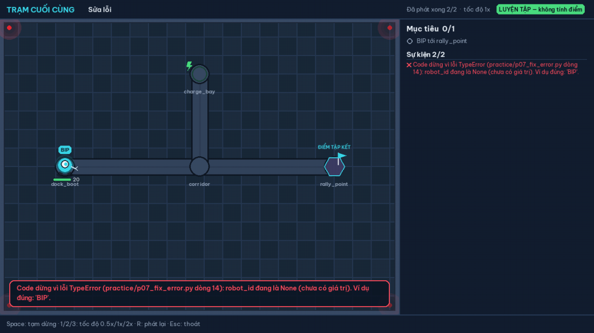

# 9. Sửa lỗi code

Khi code lỗi, game **không bị tắt**. Game hiện khung đỏ cho biết **file nào, dòng nào, lỗi gì**:

## 3 bước sửa lỗi

1. **Đọc khung đỏ:** tên file và số dòng (ở đây là `practice/p07_fix_error.py dòng 14`).
2. **Mở đúng dòng đó** trong VS Code (bấm **Ctrl+G** rồi gõ số dòng).
3. **Sửa, lưu, F5.** Lặp lại tới khi hết khung đỏ.

Muốn xem đầy đủ, bấm **Kiểm tra bài (F6)**: game hiện cả **dòng code bị lỗi** và **gợi ý**.

## Lỗi hay gặp

| Thông báo | Thường do | Ví dụ sửa |
|---|---|---|
| `... đang là None` | Hàm của bạn quên `return` | Thêm `return ten_bien` cuối hàm |
| `NameError` | Gõ sai tên biến/hàm | `ctx.mov_to` → `ctx.move_to` |
| `SyntaxError` | Thiếu `:` hoặc sai thụt lề | `def run(ctx)` → `def run(ctx):` |
| `KeyError` | Dict không có khóa đó | `print(p)` để xem các khóa |
| `TypeError` | Sai số lượng/thứ tự tham số | `move_to("rally_point", "BIP")` → `move_to("BIP", "rally_point")` |
| *Chạy quá thời gian* | `while` không bao giờ dừng | Kiểm tra điều kiện dừng của vòng lặp |

## Yên tâm

- Lỗi ở màn này **không ảnh hưởng** màn khác.
- Những gì robot làm được **trước khi lỗi vẫn được tính**.
- Thử bao nhiêu lần cũng được, không bị trừ điểm.

🧪 Luyện: **bài 7** (cố ý có 2 lỗi để bạn tập sửa).

➡️ Xem thêm: [Bảng công cụ đầy đủ](../BANG_CONG_CU.md) · [Đề và gợi ý trong game](10-de-va-cham-diem.md)
