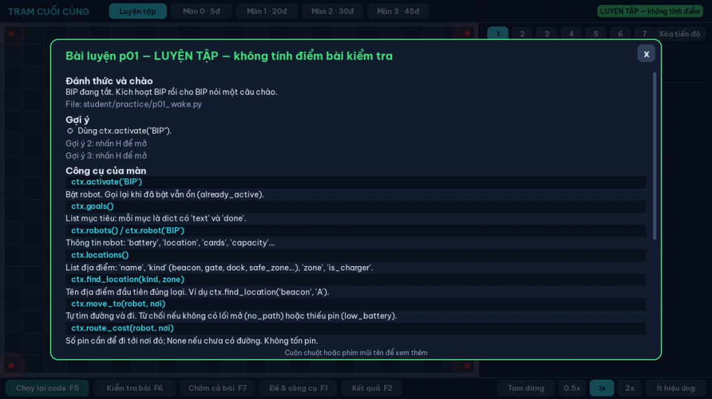

# 10. Xem đề, gợi ý và cách chấm điểm

## Xem đề và gợi ý ngay trong game

Bấm **F1 (Đề & công cụ)**. Ở bài luyện, nhấn **H** để mở thêm từng gợi ý:

## Các màn kiểm tra

| Màn | File | Nhiệm vụ | Điểm |
|---|---|---|---:|
| 0 | `student/level0_boot.py` | Đánh thức BIP, nói, tới điểm tập kết | 5 |
| 1 | `student/level1_gate.py` | Mở cổng, đưa robot tới các khu | 20 |
| 2 | `student/level2_cargo.py` | Giao kiện đúng nơi (+ OOP `PlannerBase`) | 30 |
| 3 | `student/level3_team.py` | Sửa chữa và cứu người (+ OOP `RobotBase`) | 45 |

## Chấm điểm như thế nào?

- Chấm theo **việc robot thật sự làm được**, ví dụ *Đã giao 4/6 kiện*. **Không** chấm code đẹp hay ngắn.
- **Làm được phần nào có điểm phần đó.** Các mục tiêu có điểm riêng.
- Có nhiều cách đúng: đi lẻ hay gom hàng, làm việc nào trước đều được.
- Điểm trong game chỉ là **điểm thử**. Giảng viên chấm lại từ code bạn nộp.
- Khi chấm chính thức, bài còn chạy trên **bản đồ khác cùng luật** (tên địa điểm/cổng/kiện, thứ tự, pin có thể khác).

## ⚠️ Đừng viết cứng tên

| ❌ Dễ mất điểm | ✅ Nên làm |
|---|---|
| `ctx.move_to("BIP", "beacon_A")` | `ctx.move_to("BIP", ctx.find_location("beacon", "A"))` |
| `ctx.open_gate("BIP", "gate_A")` | `for g in ctx.gates(): ctx.open_gate("BIP", g["id"])` |
| `ctx.load("BIP", "p1")` | `for p in ctx.packages(): ctx.load("BIP", p["id"])` |

Tên robot (`BIP`, `KEP`, `H1`, `H2`) và tên slot (`R1`, `S1`...) thì giữ nguyên, viết thẳng được.
